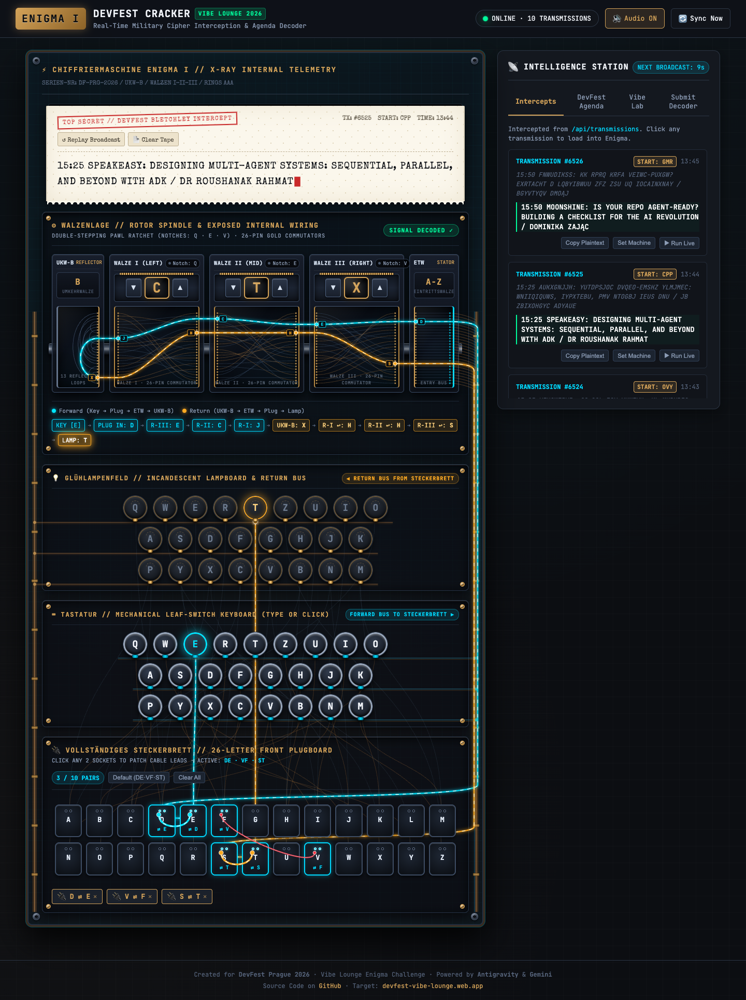

# DevFest Prague 2026 · Enigma Decoder ⚡

A real-time WWII Enigma I cipher interception engine and interactive decoder built for the **DevFest Prague 2026 Vibe Lounge Challenge** (`devfest-vibe-lounge.web.app`).

Built with **Google Antigravity** & **Gemini** · **[Live Demo ↗](https://mattskala.github.io/devfest2026-enigma/)**



---

## 📻 Live Interception & Cracking

The DevFest Vibe Lounge broadcasts the official conference agenda encrypted on an authentic Enigma I machine every 60 seconds (`/api/transmissions`). This app intercepts the transmissions, decodes them live, and compiles the official conference schedule.

### Machine Specifications (`/api/enigma`)
- **Model**: Enigma I (Heeres-Enigma / Wehrmacht M3)
- **Rotors**:
  - Rotor I: `EKMFLGDQVZNTOWYHXUSPAIBRCJ` (Turnover notch: `Q`)
  - Rotor II: `AJDKSIRUXBLHWTMCQGZNPYFVOE` (Turnover notch: `E`)
  - Rotor III: `BDFHJLCPRTXVZNYEIWGAKMUSQO` (Turnover notch: `V`)
- **Reflector**: Reflector B (`YRUHQSLDPXNGOKMIEBFZCWVJAT`)
- **Rings**: `AAA` (Ringstellung 01-01-01)
- **Plugboard (Steckerbrett)**: `DE`, `VF`, `ST`
- **Double-Stepping**: Exact historical mechanical Enigma stepping emulation.

---

## 🚀 Features

1. **Authentic Enigma I Simulation**:
   - 3D tactile Rotors with turnover notch detection and double-stepping indicators.
   - Illuminated Glühlampenfeld (Lampboard) with halogen bloom.
   - Mechanical Tastatur (Keyboard) supporting mouse, touch, and physical keyboard typing.
   - Steckerbrett (Plugboard) showing active pairs (`D⇄E`, `V⇄F`, `S⇄T`).
   - Real-time electrical circuit trace (`KEY ➔ PLUG ➔ ROTOR III ➔ ROTOR II ➔ ROTOR I ➔ REFLECTOR B ➔ ... ➔ LAMP`).

2. **Procedural Web Audio FX**:
   - Realistic typewriter key clacks and metallic ratchet steps synthesized live via Web Audio API (zero audio file dependencies, works 100% offline).
   - Incoming military radio intercept alert sound.

3. **Live DevFest Intelligence**:
   - Auto-polling `/api/transmissions` with countdown ticker.
   - Instant reciprocal decryption of all broadcasts.
   - Real-time aggregation of conference agenda (time, room, title, speaker).
   - "Run Live" animation mode that steps transmissions letter-by-letter on the mechanical machine.

4. **Leaderboard Submission**:
   - Built-in transmission directly to `/api/entries` to appear on the lounge screen.
   - Live board monitor.

---

## 💻 Local Quickstart

You can serve this repository with any static web server:

```bash
# Using Python
python3 -m http.server 8080

# Using Bun
bun x serve .

# Using Node / npx
npx serve .
```

Open `http://localhost:8080` in your browser.

---

## 🏆 Challenge Verification
- Test Vector: `start: AAA`, `plaintext: HELLO DEVFEST` ➔ `ciphertext: IABEA NVTNZMA` (Verified ✓)
- Reciprocal Property: Decrypting `IABEA NVTNZMA` at `AAA` ➔ `HELLO DEVFEST` (Verified ✓)
